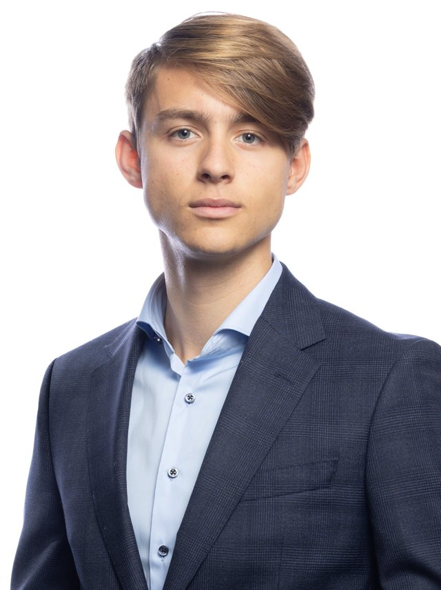

::: {.home}
::: {.home-text}
[Constitutional law · Legal theory · Legal method · Law and economics]{.fields}

I study law at the University of Fribourg, bilingually in German and French, alongside economics with a focus on public finance. I’m passionate about constitutional law, legal theory, legal method, and law and economics.

I’m a student research assistant at the Chair of Professor Frei at the distance university in Brig, and a tutor in fundamental rights. Earlier, while still at upper secondary school, I worked at the Chair of Professor Tschentscher at the University of Bern on historical constitutions. Since 2021 I’ve written Wikipedia articles on constitutional law and constitutional history. Since 2024 I’ve been supported by the Swiss Study Foundation.

### Interests

Reading, martial arts (kickboxing, Muay Thai), hiking

### Contact

Email: [schank.noam@gmail.com](mailto:schank.noam@gmail.com)\
LinkedIn: [noam-schank](https://www.linkedin.com/in/noam-schank-9a3b19434/)
:::

{.portrait fig-alt="Portrait of Noam Schank"}
:::
