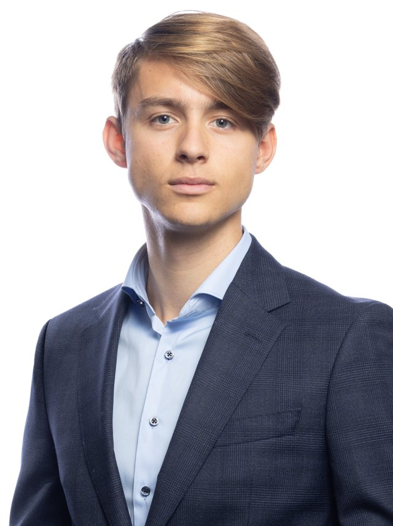

::: {.home}
::: {.home-text}
[Droit constitutionnel · Théorie du droit · Méthodologie juridique]{.fields}

J’étudie le droit à l’Université de Fribourg, en filière bilingue allemand-français, ainsi que l’économie politique avec une spécialisation en finances publiques. Mes travaux portent sur le droit constitutionnel, la théorie du droit et la méthodologie juridique.

Je suis assistant étudiant à la chaire Frei de l’Université à distance de Brigue et tuteur en droits fondamentaux. Auparavant, encore au gymnase, j’ai travaillé à la chaire Tschentscher de l’Université de Berne sur des textes constitutionnels historiques. Depuis 2021, je rédige des articles Wikipédia sur le droit public et l’histoire constitutionnelle. Je suis boursier de la Fondation suisse d’études.

### Loisirs

Lecture, sports de combat (kickboxing, muay-thaï), randonnée

### Contact

E-mail: [schank.noam@gmail.com](mailto:schank.noam@gmail.com)\
LinkedIn: [noam-schank](https://www.linkedin.com/in/noam-schank-9a3b19434/)
:::

{.portrait fig-alt="Portrait de Noam Schank"}
:::
